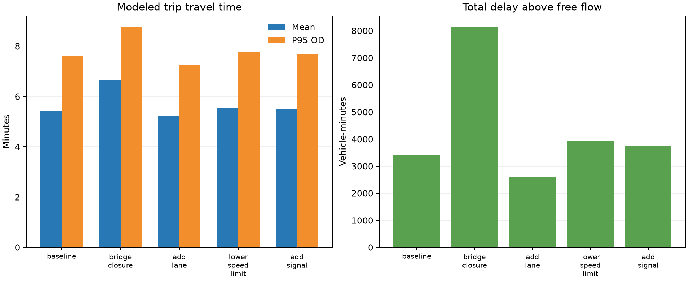

# RushHour

Test how road closures, added lanes, and speed or signal changes affect traffic congestion on real city street networks.

RushHour runs iterative traffic assignment with BPR travel times: drivers choose routes, congestion changes travel times, and the assignment repeats until flows settle. You can then compare scenarios side by side.



*Synthetic demo grid, 80 assignment iterations. Closing the marked arterial raises the modeled mean trip from 5.41 to 6.66 minutes (about 23% longer); adding a lane lowers it to 5.21. These are model outputs, not measured city data.*

## Features

- **Real networks:** OpenStreetMap, GeoJSON, Shapefile and File Geodatabase, public ArcGIS REST layers, GraphML, or roads traced from a PDF map. NYC and Tallahassee are bundled.
- **What-if scenarios:** road closure, added lane, lower speed limit, and added signal, compared against a baseline on mean and P95 trip time, total delay, and the most congested links.
- **Tunable model:** BPR alpha and beta, iterations, convergence threshold, demand scale, and a driver mix of steady commuters and flexible drivers who accept detours.
- **Your own demand:** upload an origin-destination CSV, or start from generated example trips.

## Quick start

Requires Python 3.10 or newer.

```bash
python3.12 -m venv .venv
source .venv/bin/activate          # Windows: .venv\Scripts\activate
python -m pip install -e ".[dev,gis,osm]"

streamlit run app.py               # http://localhost:8501
```

Start with the built-in demo grid, which works offline. The `gis` extra is needed for the bundled cities and GIS imports, and `osm` for OpenStreetMap downloads. There is also a CLI:

```bash
rushhour compare --output results/demo-comparison.json
```

## Documentation

See [docs/TECHNICAL.md](docs/TECHNICAL.md) for supported data sources, the model and its assumptions, CLI usage, deployment, and troubleshooting.

## Limitations

This is a static assignment model, not a minute-by-minute simulation. Default demand and capacities are uncalibrated, and street centerlines carry no traffic counts, so treat results as illustrations rather than forecasts.

## Data and license

Code is MIT licensed (see [LICENSE](LICENSE)). OpenStreetMap-derived output is © OpenStreetMap contributors. The bundled NYC and Tallahassee street files come from their cities' open data; see their sources in `data/networks/`.